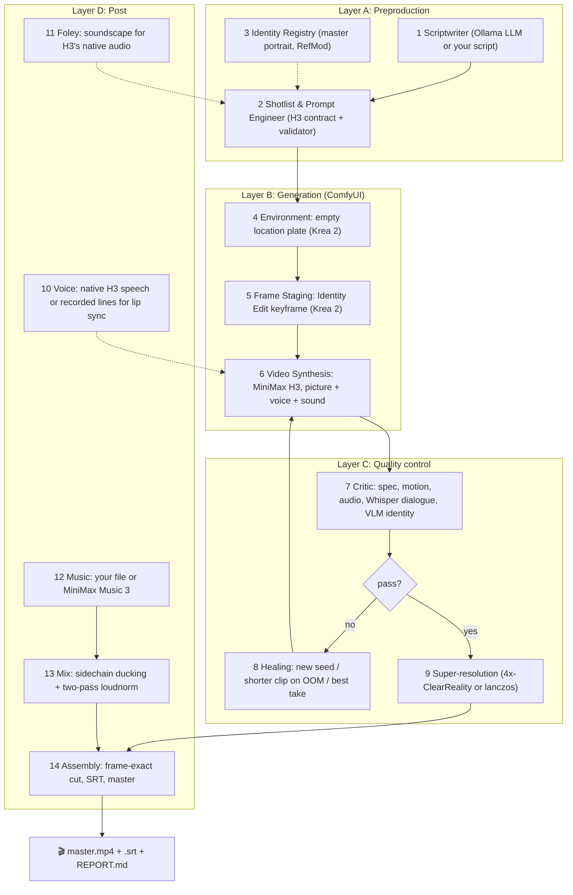

# OpenCineAgent 🎬

> **A 14-agent film production pipeline that runs on local, open models.**
> Script → identity → keyframes → video with native voice → quality control → cut, score, mix and master.
> Video by **MiniMax H3**, images by **Krea 2**, both through **ComfyUI** on your own GPU.

OpenCineAgent turns a premise (or a script you wrote) into a finished, subtitled master. Every shot is
rendered as a real clip with synchronized dialogue and sound, checked automatically, retried when it
fails, and assembled frame-accurately. Nothing is simulated: if a model, node or tool is missing, it
tells you exactly what and where to get it.

The production rules come from real projects made with this stack (music videos, commercials and a
40+ episode short-form series) and are written down in [docs/PRODUCTION_NOTES.md](docs/PRODUCTION_NOTES.md).

---

## What it is good for (honestly)

| Goal | Fit |
|---|---|
| Short films, trailers, music videos, series of 30-90 s episodes | ✅ Works today, with a human approving identities |
| Previsualization: script, shot list, prompts, animatic-grade clips | ✅ |
| A feature film, fully unattended | ❌ Not yet. Render time is feasible (~7 min per 15 s on a 16 GB GPU), but keeping faces, wardrobe and space consistent across hundreds of shots still needs human review |

Each H3 clip is 5 to 15 seconds. There is no lip sync for dubbed audio unless you supply recorded lines (see *Voice*).

---

## 🧬 Models (open weights)

Download the files into `ComfyUI/models/<folder>/`. `python main.py models` prints this table and marks what you already have.

### MiniMax H3: video + native audio ([Comfy-Org/MiniMax-H3](https://huggingface.co/Comfy-Org/MiniMax-H3))
Original release: [MiniMaxAI/MiniMax-H3](https://huggingface.co/MiniMaxAI/MiniMax-H3) · [announcement](https://www.minimax.io/blog/minimax-h3) · **read the [license](https://huggingface.co/MiniMaxAI/MiniMax-H3/blob/main/LICENSE) before commercial use.**

| File | Folder | Download |
|---|---|---|
| `minimax_h3_ref2va_pruned_int8_convrot.safetensors` | `diffusion_models` | [link](https://huggingface.co/Comfy-Org/MiniMax-H3/resolve/main/diffusion_models/minimax_h3_ref2va_pruned_int8_convrot.safetensors) |
| `qwen3vl_32b_minimax_h3_nvfp4_awq.safetensors` | `text_encoders` | [link](https://huggingface.co/Comfy-Org/MiniMax-H3/resolve/main/text_encoders/qwen3vl_32b_minimax_h3_nvfp4_awq.safetensors) |
| `minimax_h3_video_vae_fp16.safetensors` | `vae` | [link](https://huggingface.co/Comfy-Org/MiniMax-H3/resolve/main/vae/minimax_h3_video_vae_fp16.safetensors) |
| `minimax_h3_audio_vae_fp32.safetensors` | `vae` | [link](https://huggingface.co/Comfy-Org/MiniMax-H3/resolve/main/vae/minimax_h3_audio_vae_fp32.safetensors) |
| `minimax_h3_ref2v_turbo_4step_v0.1_comfyui_bf16.safetensors` (4-step turbo) | `loras` | [link](https://huggingface.co/Comfy-Org/MiniMax-H3/resolve/main/loras/minimax_h3_ref2v_turbo_4step_v0.1_comfyui_bf16.safetensors) |

### Krea 2: keyframes, portraits, location plates ([Comfy-Org/Krea-2](https://huggingface.co/Comfy-Org/Krea-2))
Guide: [docs.comfy.org › Krea 2](https://docs.comfy.org/tutorials/image/krea/krea-2)

| File | Folder | Download |
|---|---|---|
| `krea2_turbo_fp8_scaled.safetensors` | `diffusion_models` | [link](https://huggingface.co/Comfy-Org/Krea-2/resolve/main/diffusion_models/krea2_turbo_fp8_scaled.safetensors) |
| `qwen3vl_4b_fp8_scaled.safetensors` | `text_encoders` | [link](https://huggingface.co/Comfy-Org/Krea-2/resolve/main/text_encoders/qwen3vl_4b_fp8_scaled.safetensors) |
| `qwen_image_vae.safetensors` | `vae` | [link](https://huggingface.co/Comfy-Org/Krea-2/resolve/main/vae/qwen_image_vae.safetensors) |
| `krea2_identity_edit_v1_2.safetensors` ([conradlocke/krea2-identity-edit](https://huggingface.co/conradlocke/krea2-identity-edit), check its license) | `loras` | [link](https://huggingface.co/conradlocke/krea2-identity-edit/resolve/main/krea2_identity_edit_v1_2.safetensors) |

### Optional
| What | Where |
|---|---|
| MiniMax Music 3 (score generation, `OPENCINE_MUSIC_MODE=minimax`) | [Comfy-Org/MiniMax-Music-3](https://huggingface.co/Comfy-Org/MiniMax-Music-3): `minimax_music3_dit_fp16`, `minimax_music3_text_encoder_pruned_int8_convrot`, `minimax_music3_dav` |
| 4x-ClearRealityV1 upscaler (`OPENCINE_UPSCALE_MODE=clearreality`) | [openmodeldb.info/models/4x-ClearRealityV1](https://openmodeldb.info/models/4x-ClearRealityV1) |
| QC vision model (identity check) | `ollama pull qwen2.5vl:7b` |
| Scriptwriter LLM | `ollama pull qwen3:8b` |

Fine-tunes work too. Set them in `.env`; see `.env.example` for a distilled H3 fine-tune (8 steps, no turbo LoRA) and the two-pass recipe for Krea 2 mixes.

### ComfyUI custom nodes

| Package | Used for | Required |
|---|---|---|
| [comfyui-krea2edit](https://github.com/lbouaraba/comfyui-krea2edit) | Krea 2 Identity Edit (keyframes) | yes |
| [ComfyUI-MiniMaxH3Mod](https://github.com/Luisacaotica/ComfyUI-MiniMaxH3Mod) | RefMod identity anchors | optional |
| [ComfyUI-Pixaroma](https://github.com/pixaroma/ComfyUI-Pixaroma) | Lip sync to recorded voice lines | optional |
| [ComfyUI-PlagueKind-Nodes](https://github.com/PlagueKind/ComfyUI-PlagueKind-Nodes) | `H3SLAAttention` (faster, cleaner speech) | optional |

MiniMax H3, video and audio nodes are part of ComfyUI core: update ComfyUI first.

---

## 🏛️ The 14 agents



How identity is kept across shots:
`master portrait (approved once)` → `Identity Edit into the locked location plate` = keyframe →
H3 gets `<Picture 1>` = keyframe and `<Picture 2..>` = master portraits, the same identity block in
every prompt, `ref_image_size: max`, and a RefMod only when one face is on screen.

---

## 🚀 Quickstart

Requirements: Python 3.10+, FFmpeg, [ComfyUI](https://github.com/comfyanonymous/ComfyUI) (recent) with the models
and nodes above, an NVIDIA GPU (developed on 16 GB; the H3 text encoder alone is ~15 GB on disk), and optionally [Ollama](https://ollama.com).

```bash
git clone https://github.com/ProgramaGrueso/OpenCineAgent.git
cd OpenCineAgent
python3 -m venv .venv && source .venv/bin/activate
pip install -e '.[qc]'        # [qc] adds faster-whisper for dialogue checks
cp .env.example .env          # point it at your ComfyUI / models

python main.py doctor         # ComfyUI nodes + models, Ollama, FFmpeg
python main.py models         # what to download and where
```

### 1. Cast
Characters live in `config/characters/registry.json` (description, face, wardrobe, voice, optional Krea 2 LoRA).

```bash
python main.py cast elena_vance                     # renders 2 master portrait candidates
python main.py approve elena_vance config/characters/elena_vance/candidates/seed_XXXX.png
python main.py refmod elena_vance                   # optional, needs ComfyUI-MiniMaxH3Mod
```

### 2. Plan (no GPU)
```bash
python main.py plan --script examples/rooftop_confrontation.json
# or let the local LLM write it:
python main.py plan -p "Elena confronts Victor on a rainy rooftop" -c elena_vance -c victor_cross --language Spanish
```
Read `workspace/productions/<title>/plan.json`: every Krea 2 and H3 prompt is there.

### 3. Render
```bash
python main.py run --script examples/rooftop_confrontation.json --only SH_002   # hardest shot first
python main.py run --script examples/rooftop_confrontation.json                 # the rest; finished shots are reused
```
Output in `workspace/productions/<title>/`: `<title>_master.mp4`, `.srt`, `REPORT.md` (per-shot QC:
passed / failed / **not verified**), every take under `clips/`, keyframes, plates and `state.json`.

Useful flags: `--music score.wav` (a file you own), `--burn-subtitles`, `--force`, `--auto-approve` (skips portrait review, not recommended).

---

## ✍️ Script format

See [examples/rooftop_confrontation.json](examples/rooftop_confrontation.json). Per shot: `shot_type`,
`camera_motion`, `action_description` (present tense, visible), `character_ids` (speaker first),
`dialogue` (≤130 characters per line, one speaker per shot), `sound_description`, `duration_sec` (≤15).
A scene can use a photo of a real place with `location_image`.

**Voice.** By default H3 speaks the lines itself, in the voice described in the character profile;
Whisper checks the words. To use recorded lines (an actor, a TTS take), add `audio_path` to every
line of the shot: the agent builds a per-clip track at the exact offsets and H3 lip-syncs to it
(needs ComfyUI-Pixaroma). Only use voices you have the rights to.

---

## ⏱️ Real timings (RTX 4070 Ti SUPER 16 GB)

| Step | Time |
|---|---|
| Krea 2 portrait / plate / keyframe | 20 s - 1.5 min each |
| MiniMax H3 clip, 124-262 frames | ~1.5-3 min (8-step distilled); first load of the UNET takes several minutes |
| A 45 s episode (3 clips x 15 s) | ~22 min |
| 50 s commercial, 13 clips + retakes, upscale, mix | ~1 h 15 min |

---

## 🧪 Tests

```bash
pip install -e '.[dev]'
pytest
```
The suite runs the whole pipeline against a test double of ComfyUI that writes real media with
FFmpeg, so orchestration, QC, healing, cutting and mixing are tested without a GPU. Graph builders
are checked for broken links, and client-side validation for missing nodes and models.

---

## 📄 License
Code: Apache License 2.0. Model weights have their own licenses: check each model card before
commercial use. Do not use RefMods, LoRAs or voices of real people without their consent.
