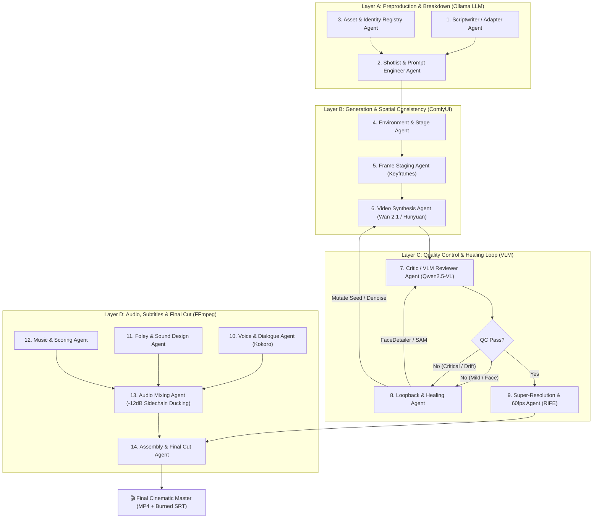

# OpenCineAgent 🎬
> **Modular 14-Agent Production Pipeline for Autonomous Open Cinema**  
> *100% Local, Open-Source & Automated Generative Filmmaking Stack*

---

## 🏛️ Architecture Blueprint: The 14 Autonomous Agents

OpenCineAgent splits the cinematic production process into **four functional layers** coordinated by an asynchronous central orchestrator and event bus:



---

### Layer A: Preproduction & Breakdown (Local LLM / Ollama)
1. **Scriptwriter / Adapter Agent**: Converts user premises into technical screenplays formatted with scenes, shots, action descriptions, dialogue lines, and emotional beats.
2. **Shotlist & Prompt Engineer Agent**: Compiles shot definitions into visual specifications (Wan 2.1 / Hunyuan / AnimateDiff prompt syntax, camera grammar, deterministic seeds).
3. **Asset & Identity Registry Agent**: Maintains fixed facial vectors, LoRA weights, and invariable clothing/silhouette prompts for canonical characters.

### Layer B: Generation & Spatial Consistency (ComfyUI Headless)
4. **Environment & Stage Agent**: Locks empty background architectures and depth maps before inserting characters to guarantee spatial consistency across shots.
5. **Frame Staging Agent (Keyframes)**: Generates the initial still keyframe using IP-Adapter Face / PuLID / InsightFace + ControlNet OpenPose.
6. **Video Synthesis Agent**: Injects keyframes into Wan 2.1 (1.3B/14B) or HunyuanVideo via the ComfyUI REST/WebSocket batch queue.

### Layer C: Automated Quality Control & Healing Loop
7. **Critic / VLM Reviewer Agent**: A local multimodal model (Qwen2.5-VL / MiniCPM-V) inspects 4 extracted video frames checking for deformed faces, hands with >5 fingers, and identity drift. Returns deterministic JSON:
   ```json
   {
     "pass": true,
     "identity_drift_score": 0.08,
     "deformed_faces": false,
     "deformed_hands": false,
     "motion_jitter": false,
     "error_codes": []
   }
   ```
8. **Loopback & Healing Agent**:
   - **Mild Error (Face Asymmetry)**: Triggers FaceDetailer / SAM inpainting pass.
   - **Critical Error (Motion Jitter / Extra Digits)**: Mutates seed (`seed + 7919`), reduces `motion_bucket_id` (-20%) and denoise, and re-enqueues the generation pass.
9. **Super-Resolution & Frame Rate Agent**: Interpolates approved clips to 60 fps (RIFE) and upscales to 1080p/4K master resolution.

### Layer D: Audio, Subtitles & Final Cut
10. **Voice & Dialogue Agent**: Synthesizes spoken character dialogue using Kokoro-TTS / F5-TTS with fixed vocal timbres per character.
11. **Foley & Sound Design Agent**: Generates synchronized footsteps, rain textures, impacts, and ambient Foley sound effects.
12. **Music & Scoring Agent**: Composes mood-based atmospheric score beds per scene.
13. **Audio Mixing Agent (Sidechain / Ducking)**: Dynamically attenuates background music and Foley by **-12 dB** during spoken dialogue using FFmpeg `sidechaincompress`, followed by EBU R128 `loudnorm` mastering.
14. **Assembly & Final Cut Agent**: Stitches approved video clips, attaches the multichannel master audio stem, and burns synchronized SRT/ASS subtitles with cinematic typography.

---

## 🛠️ 100% Open & Local Tech Stack

| Role | Technology |
|---|---|
| **Headless Generation Engine** | ComfyUI (`--listen --port 8188`) via REST API |
| **Video Generation Engine** | Wan 2.1 (14B/1.3B) / HunyuanVideo / AnimateDiff |
| **Facial & Identity Consistency** | PuLID / IP-Adapter Plus Face SDXL |
| **Multimodal Reviewer (QC)** | Qwen2.5-VL / Qwen3 via Ollama |
| **Voice Synthesis & Foley** | Kokoro-82M / F5-TTS / Mathematical Harmonics |
| **Mastering & Assembly** | FFmpeg with `sidechaincompress`, `loudnorm`, `minterpolate` |
| **Central Orchestrator** | Python 3.10+ with Async Event Bus & Typer/Rich CLI |

---

## 🚀 Quickstart Guide

### 1. Clone & Setup Environment
```bash
git clone https://github.com/ProgramaGrueso/OpenCineAgent.git
cd OpenCineAgent

# Create and activate virtual environment
python3 -m venv .venv
source .venv/bin/activate

# Install package and dependencies
pip install -e .
```

### 2. Verify Local Infrastructure
```bash
python main.py healthcheck
```

Output:
```
                 Local Infrastructure Components                 
┏━━━━━━━━━━━━━━━━━━━━━┳━━━━━━━━━━━━━━━━━━━━━━━━┳━━━━━━━━━━━━━━━━┓
┃ Component           ┃ Endpoint / Path        ┃ Status         ┃
┡━━━━━━━━━━━━━━━━━━━━━╇━━━━━━━━━━━━━━━━━━━━━━━━╇━━━━━━━━━━━━━━━━┩
│ ComfyUI Headless    │ http://127.0.0.1:8188  │ ONLINE (Ready) │
│ Ollama Local Daemon │ http://127.0.0.1:11434 │ ONLINE (Ready) │
│ FFmpeg Engine       │ /usr/bin/ffmpeg        │ INSTALLED      │
└─────────────────────┴────────────────────────┴────────────────┘
```

### 3. List Registered Characters
```bash
python main.py characters
```

### 4. Run Independent VLM Quality Control (Agent 7 Standalone)
```bash
python main.py qc /path/to/clip.mp4 --shot-id SH_001
```

### 5. Generate Full Autonomous Production
```bash
python main.py run --premise "Elena Vance confronta a Victor Cross en la terraza de un rascacielos bajo la lluvia"
```

The assembled cinematic master video and subtitles will be saved in `workspace/outputs/`.

---

## 🐳 Docker Deployment

To spin up ComfyUI and Ollama with GPU acceleration alongside OpenCineAgent:

```bash
docker compose up -d
```

---

## 🧪 Testing

OpenCineAgent includes an automated test suite covering all 14 agents and end-to-end integration:

```bash
pytest -v tests/
```

---

## 📄 License
Apache License 2.0. Open-source for the autonomous filmmaking community.
